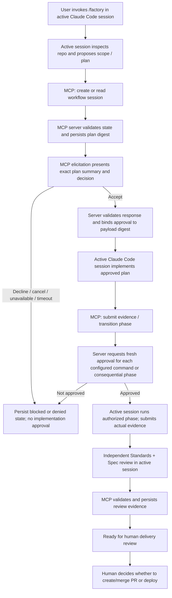

# Claude Code active-session host bridge decision

**Status:** Architecture selected by the repository owner on 2026-10-20 and implemented in the local MCP bridge. Deterministic bridge and hook tests exist; the real interactive Claude Code host smoke test remains **NOT RUN / UNVERIFIED**. Do not interpret implementation or CI success as proof of installed-host compatibility.

## Decision

Preserve the **currently active Claude Code session** as the only model orchestrator. Use a local Model Context Protocol (MCP) server as a narrow state-and-approval bridge. Do not start a second Claude CLI process to perform the main workflow.

The current `runFactoryWorkflow` composition is a single asynchronous function with an `implementApprovedPlan` callback. That callback model does not fit the active-session control flow: while an MCP tool call is waiting inside the function, the active model cannot be handed the implementation task and then resume the same call with its result. The host bridge therefore uses an incremental, persisted workflow-session API. The implemented bridge reuses the existing domain, state, approval, evidence, and recovery contracts where appropriate.

## Why MCP is the leading bridge

Claude Code documents MCP servers/tools and MCP elicitation for asking the user for input during a tool call. See the [Claude Code MCP documentation](https://code.claude.com/docs/en/mcp) and [Claude Code hooks reference](https://code.claude.com/docs/en/hooks).

Hooks are useful defense-in-depth, particularly when blocking selected tool calls, but are not sufficient as the primary bridge. A command hook communicates through process I/O and cannot directly call a new tool or resume the active model's orchestration. A tool server gives the active session explicit, typed operations and a place to own persisted state transitions.

**Important:** the bridge is implemented and its deterministic tests exercise simulated host behavior, but this does not prove the server is correctly configured in a user's installed Claude Code version or that a real human approval interaction works. A manual interactive smoke test remains mandatory and is currently unverified.

## Control flow

The MCP server does not run the model implementation callback. The active session performs model-driven work and reports structured evidence. The server validates allowed transitions, approval payloads, and evidence shape; it cannot independently prove that a model's claimed test output is genuine unless the check is run by a trusted execution boundary and its result is captured there.

## Implemented MCP tool surface

The bridge exposes the following phase-oriented tools:

| Tool | Purpose | Required invariant |
| --- | --- | --- |
| `factory_session_create` | Create a run with request, repository identity, and initial revision | Validate inputs; never overwrite an existing run |
| `factory_session_get` | Read current phase, revision, and evidence summary | Read-only; redact secrets |
| `factory_plan_request_approval` | Present the exact proposed plan and request user approval | Approval must come from host elicitation response, not a model argument |
| `factory_phase_transition` | Advance a run using expected revision and allowed transition | Reject stale revision and illegal transition |
| `factory_action_request_approval` | Request approval for an exact command/action payload | Display target, command/action, reason, and payload digest; default-deny |
| `factory_evidence_submit` | Record verification/review evidence from the active session or trusted runner | Schema-check; mark source and trust level; never promote unverified claims to trusted execution evidence |
| `factory_delivery_status` | Report whether gates passed and human delivery review is pending | Must not create PRs, merge, deploy, or publish |

The public tool surface is implemented. Actual compatibility with the installed Claude Code client remains unverified until the interactive smoke test is run. The bridge intentionally has no generic arbitrary-shell execution tool.

## Human approval contract

1. The server constructs the canonical action payload itself from validated workflow state and the proposed action. It does not accept a caller-supplied digest as proof.
2. The elicitation message clearly displays the action type, target/repository, exact command or plan summary, reason, and a short payload digest. Do not place secrets in the prompt or form.
3. The host's elicitation response must be an explicit accept. Decline, cancel, timeout, unsupported capability, malformed response, connection failure, or persistence failure means no approval and no phase advance.
4. On accept, the server records the decision and actor provenance available from the host integration, then consumes the approval exactly once against the same canonical payload immediately before the protected operation.
5. A changed payload, working directory, target, command argument, plan revision, or digest requires a new human decision.
6. Do not represent the MCP server's self-reported actor string as authenticated identity. Document the actual identity guarantees the host exposes; if identity cannot be authenticated, record that limitation rather than inventing an identity claim.

Elicitation responses are user input, not inherently trustworthy authorization tokens. The server must validate the response shape and bind it to its own pending request state. Never treat a boolean or text field supplied as a normal model tool argument as human approval.

## State and ownership

- The active Claude Code session remains the only model orchestrator and the sole writer of the user-facing `factory/board.json`.
- The MCP server is the authority for its own persisted workflow-session records and approval ledger. Those records must use revision checks, atomic persistence appropriate to the supported deployment model, and an auditable event trail.
- The board and the server ledger are separate artifacts unless a future design introduces a transactional shared store. Do not pretend a JSON board write and an approval-ledger write are one atomic transaction.
- The local MCP server should bind to the narrowest supported local transport and workspace scope. Do not expose an unauthenticated network listener by default.
- Tool arguments, repository files, issue text, subagent output, model text, and verification summaries are untrusted. Treat JSON Schema validation as shape validation, not proof of authorization or truth.

## Verification status and remaining host acceptance

### Deterministic tests (implemented; run in CI)

- Tool input validation and strict allowlisted phase transitions.
- Happy path through plan approval, implementation-evidence handoff, verification, review, and human-delivery-ready status.
- Elicitation accept binds approval to the exact server-created payload.
- Decline, cancel, timeout, unsupported elicitation capability, malformed response, and persistence failure all fail closed.
- Changed payload and stale revision are rejected.
- Approval is single-use; replay is rejected.
- An implementation or verification outcome marked ambiguous cannot be silently retried.
- Tool handlers do not execute arbitrary shell commands, create PRs, merge, deploy, or publish.
- Restart/recovery preserves blocked/interrupted state and audit history.

### Real interactive smoke test (NOT RUN; required before claiming the host bridge works)

1. Install/configure the MCP server for a trusted local test repository using the supported Claude Code MCP configuration.
2. Invoke `/factory` in an interactive Claude Code session and confirm the server's plan approval request visibly reaches the human.
3. Choose **decline** and verify that the workflow remains blocked and no implementation phase starts.
4. Start a fresh test run, approve the exact plan, and confirm that the active session—not a spawned second Claude CLI process—continues implementation.
5. Verify a modified action requires a new approval and that an unavailable/failed elicitation path blocks.
6. Capture the Claude Code version, transport/configuration, observed UI behavior, commands, exit statuses, and limitations. Do not claim this smoke test passed unless it was actually run.

## Security boundaries and residual risks

- MCP elicitation is an interaction mechanism, not a security sandbox.
- Claude Code tool permissions and local hooks remain important for enforcing filesystem and command boundaries outside the bridge.
- A local JSON store/cooperative lock is not distributed durability. If multiple MCP processes or hosts are supported, use a store with the needed transactional and concurrency semantics before claiming multi-host safety.
- The active model can submit false evidence. Checks requiring strong proof should execute through a trusted runner with bounded executable allowlists and captured exit status/output, not merely accept prose.
- No approval means no consequential action. No automatic merge, deploy, publish, or external delivery action is in scope.

## Follow-up

The bridge implementation, deterministic failure/recovery coverage, report template, and report validator are present in the repository. The outstanding acceptance gap is an actual interactive run against the target Claude Code installation, with the version and observed outcomes recorded in `docs/claude-code-smoke-report-template.md` and the completed report validated with `npm run validate:smoke-report -- <report-path>`. Do not fill the template with inferred or simulated observations. The bridge's local JSON state and cooperative lock are not tamper-evident or multi-host transactional, and the standalone CLI does not provide a trusted review provider by default.

Implementation is tracked separately in [issue #38](https://github.com/Anwarkamal143/super-agents/issues/38). The original end-to-end acceptance issue [#35](https://github.com/Anwarkamal143/super-agents/issues/35) remains open until the incremental bridge and real interactive path are implemented and verified.
